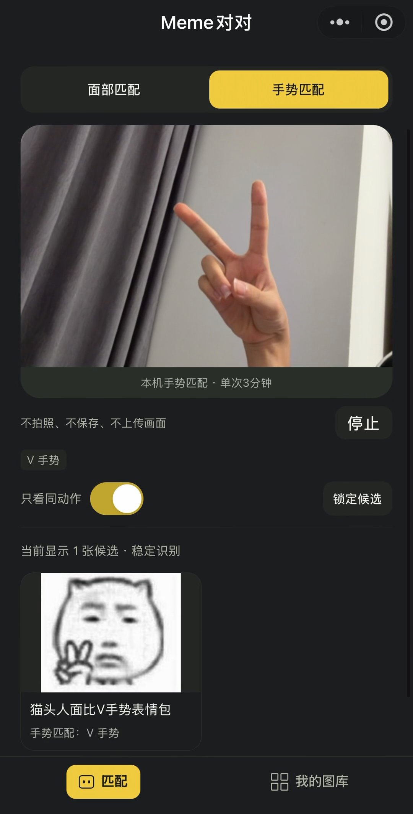
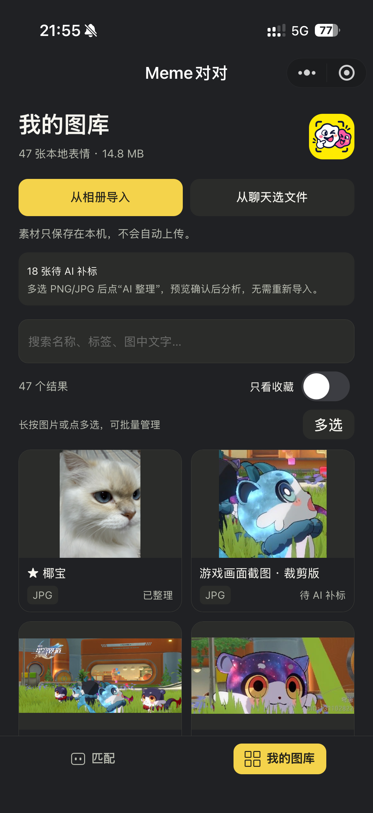
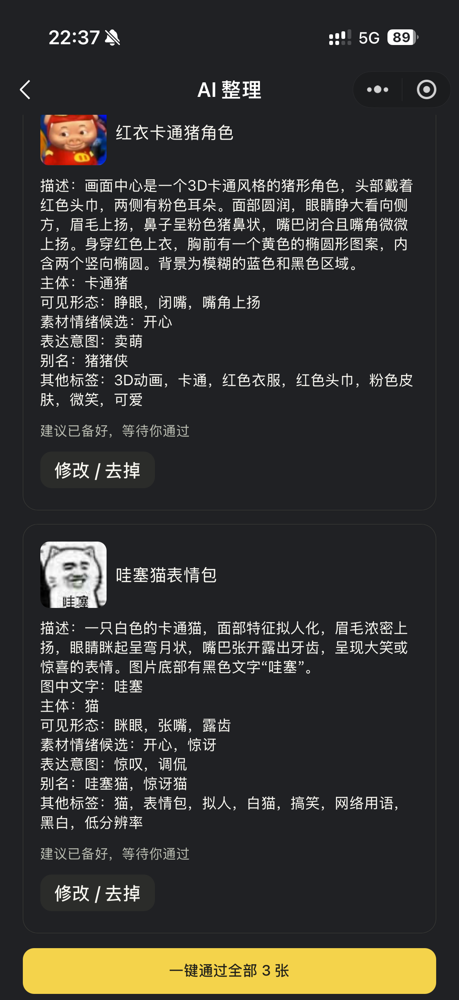
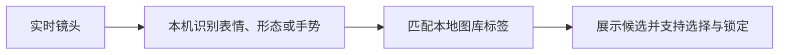

# Meme对对

**以表情与手势匹配为核心的趣味微信小程序，支持AI整理和标签搜索。**

原生微信小程序 · TypeScript / WXML / WXSS · 本机识别 · 视觉模型API · AI辅助开发

▶ **[观看开发版真机演示：用表情和手势找表情包，我做了个小程序](https://www.bilibili.com/video/BV1zTn564EdN/)**

作者：[TreeeggZ](https://github.com/TreeeggZ) · 更新：2026-10-23

本仓库展示项目功能、实现思路与演示材料，暂不包含源码。视频已发布，小程序仍在持续迭代，尚未公开上线。

## 为什么做这个项目

项目源于大学期间基于PyTorch的桌面原型：根据识别到的表情情绪匹配表情包。本次尝试AI辅助开发（vibe coding），将早期思路重新实现为微信小程序，并扩展面部形态、手势匹配与图库管理，探索“做个表情、比个手势，看看会找到什么”的互动玩法。

聊天时难以翻到想用的表情包，是另一个出发点。在匹配之外，项目加入AI生成描述和标签、人工确认保存以及关键词搜索，让导入的图片更容易整理和找回。匹配是核心交互探索，AI整理与标签体系为匹配和搜索提供支持。

**当前范围：**支持用户导入图片文件建立图库，尚未直接接入微信收藏表情包。表情与手势匹配主要探索趣味体验，其查找效率仍待验证。

## 可以做什么

| 功能 | 交互与实现 |
| --- | --- |
| 趣味面部匹配 | 从实时镜头提取嘴形、眼形等形态及表情情绪类别，匹配图库标签并展示候选 |
| 趣味手势匹配 | 支持V、点赞、张掌等手势，可锁定候选并进入素材详情 |
| AI整理 | 用户确认图片批次后调用视觉模型生成建议，经人工修改、确认后保存 |
| 标签搜索与图库管理 | 搜索已导入的图片，支持收藏、标签编辑与批量管理，素材保存在本机 |
| 裁剪制作 | 调整裁剪区域、预览成品并保存，便于继续管理和查找 |

## 实际界面

下列画面来自开发版截图或真实录屏抽帧，可能来自不同录制批次。面部相机区域已做模糊处理，界面输出保持原样。

| 趣味面部匹配 | 趣味手势匹配 |
| :---: | :---: |
|  |  |

| 本地图库 | AI建议与人工确认 |
| :---: | :---: |
|  |  |

面部示例画面当时只使用了情绪候选，不据这一帧推断形态与情绪同时命中。截图中的图库数量、批次数量只代表拍摄时状态。

## 怎样实现

两条流程共用本地图库：匹配时读取已有标签，整理图片时补充或修改标签。

### ① 核心交互：从镜头到匹配结果

镜头识别在本机执行，再用识别结果查找已有图库标签。这里的“情绪”指模型输出的表情类别，不代表对真实心理状态的判断。

### ② 图库准备：让图片有可匹配、可搜索的标签

描述与标签可手动编辑，也可借助AI生成建议。选择AI整理时，仅将用户确认的图片批次交给云端视觉模型；建议经人工修改、确认后保存。实时镜头识别不依赖这一步云端调用。

## 个人职责

负责需求拆解、页面与交互设计、模型和API接入，以及真机验证和迭代；使用AI辅助编码、理解实现与排错。Python用于模型检查与评测，小程序业务使用TypeScript。

开发中重点处理了两类问题：一是打通图片导入、AI建议、人工确认、保存与搜索的完整流程；二是在趣味匹配中处理相机目标移除、会话清理和恢复，避免界面持续使用过期结果。具体过程见[技术与迭代说明](docs/implementation.md)。

## 当前状态

- 已有公开的开发版真机演示，覆盖匹配、整理、搜索与裁剪等流程。
- 截至2026-10-22，小程序备案已完成，正式版本审核与发布准备仍在推进。
- 持续改进推荐相关性、异常反馈与设备兼容；视频展示不等于全设备或长期稳定性验收。

后续若公开代码，将在本仓库补充运行环境、配置示例和版本说明。
